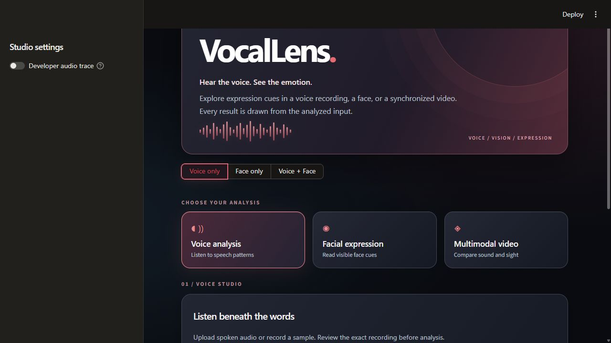
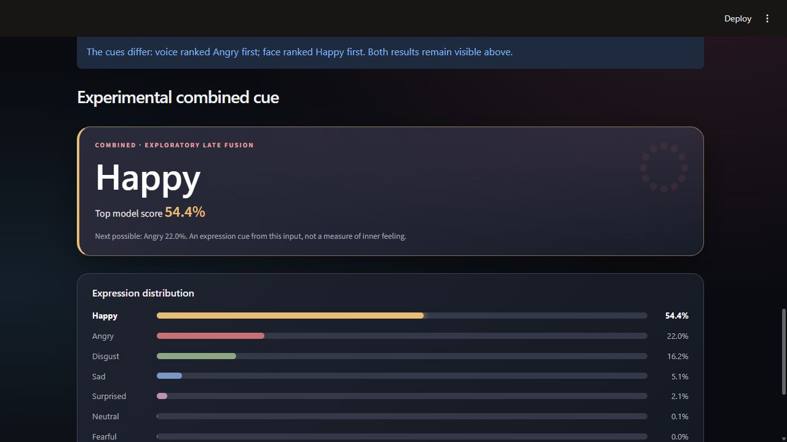

# VocalLens

**Hear the voice. See the emotion.** Local Streamlit demonstration of speech, face and experimental audiovisual expression cues. Team: Ahmad Ali Shah, Saboor Khan, Sardar Bilal.

VocalLens analyzes the current upload or browser recording. It shows real saved-model scores, input details and optional developer diagnostics. Its midnight charcoal interface keeps the `#e46b72` coral identity and adds distinct expression colors. The speech model was trained in this project; the facial OpenCV Zoo model is pretrained. Neither can determine a person's actual feelings.

## Windows setup

See the [six-minute classroom demo](demo/README.md), [speaking script](demo/DEMO_SCRIPT.md), and [real screenshot gallery](docs/SCREENSHOTS.md).





Screenshots use actual model outputs; RAVDESS frames are attributed and licensed in the gallery.

Use Python **3.12**. From PowerShell in this project directory:

```powershell
py -3.12 -m venv .venv
.\.venv\Scripts\python.exe -m pip install -r requirements.txt
.\.venv\Scripts\python.exe scripts\download_face_model.py
.\.venv\Scripts\python.exe -m streamlit run app.py
```

The selected speech model and reports are included. Speech datasets are not needed merely to run the app. Face and video modes need the official 4.8 MB OpenCV Zoo expression model and 0.2 MB YuNet detector, downloaded separately with SHA-256 verification. To reproduce the retired FER+ comparison, add `--include-ferplus` to the download command. CPU inference works; GPU use requires a compatible ONNX Runtime CUDA installation and was not tested here. From Command Prompt, use `cd /d "C:\Users\ahmad\Desktop\Emotion Recognition"` then `.venv\Scripts\python.exe -m streamlit run app.py`. The system `python` from `C:\Users\ahmad` may select Python 3.14 without Streamlit.

## Modes

- **Voice only:** upload WAV, MP3, FLAC or OGG spoken audio or record via the browser microphone. Preview, then select **Analyze voice**. Silence, corrupt or too-short files fail; a conservative single-frequency check rejects pure tones. Clipped and very short clips receive a warning. Music, noise and crying can still yield unreliable labels because there is no validated speech or out-of-distribution detector. The optional developer trace gives the file hash, processed signal, feature version, saved-model hash and exact scores.
- **Face only:** choose **Photo**, **Video**, or **Webcam**. JPG/JPEG, PNG and WebP photos are previewed, validated and scored per numbered detected face. Video samples up to 12 frames and scores the largest face in each; multiple people may switch across frames, so it warns. Missing faces produce no prediction. No identity recognition is performed.
- **Voice + Face:** upload a short video with a visible face and audio track. The app extracts the actual audio, samples up to 12 frames, shows both independent results, and displays an explicitly experimental shared-class average. Agreement and disagreement remain visible. One held-out acted actor evaluation is in [the face report](reports/face_improvement.md).

Browser camera and microphone permission are needed for capture. Uploaded video is limited to 50 MB and two minutes. The first 12 seconds of decoded audio are used for voice scoring. MP3 decoder support can vary; WAV is safest for a demo.

## Speech training and actual results

The retained **baseline calibrated SVM** used 46 features and RAVDESS only. Its six-actor held-out accuracy was 44.17% and macro F1 39.75%; baseline logistic regression was 40.00% / 39.27%, random forest 39.17% / 37.38%. A previous tuned SVM reached 44.72% / 40.86% but was not deployed because its gain was uncertain.

The selected **logistic regression with 130 features** adds MFCC delta and delta-delta summaries plus spectral bandwidth and rolloff. Training-only three-fold actor GroupKFold selected it by macro F1 (**0.4093**). The candidate uses 1,079 RAVDESS clips from 18 training actors plus 490 TESS clips from one actor (70 per compatible class). The six original RAVDESS test actors, TESS's second actor and all ten EmoDB actors remained untouched during model selection.

| Untouched test | Clips / speakers | Saved SVM accuracy / macro F1 | Selected model accuracy / macro F1 |
|---|---:|---:|---:|
| RAVDESS unseen actors | 360 / 6 | 44.17% / 39.75% | **45.83% / 45.12%** |
| TESS unseen actor | 1,400 / 1 | 33.86% / 24.08% | **37.79% / 33.37%** |
| EmoDB unseen German corpus | 454 / 10 | 11.01% / 10.72% | **31.94% / 30.04%** |

These results show better transfer on two *acted* external tests. EmoDB performance remains low, and TESS has only two female speakers. There is no labeled test of natural conversation, accents, phone recordings, noisy rooms or music; **real-world generalization has not been established**. Scores are model outputs, not calibrated certainty about a person. The full per-class reports, precision, recall, class distribution and confusion matrices are in [evaluation.json](results/expanded/evaluation.json) and [model report](reports/expanded_model.md).

The notorious near-fixed Fearful score of the old SVM on stock audio came from RBF saturation far outside its training features, not stale uploads or fabricated values. See [deep diagnostics](TESTING.md). The new model is a genuine classifier trained on more data, but an unsuitable file can still yield a misleading output.

## Reproduce training

Large raw files are excluded from Git. The [dataset audit and access guide](data/EXPANDED_DATASETS.md) explains source licenses and label maps. RAVDESS, TESS and EmoDB are downloaded from official repositories; TESS and EmoDB archives have recorded SHA-256 checks. To regenerate the experiment:

```powershell
.\.venv\Scripts\python.exe scripts\download_dataset.py
.\.venv\Scripts\python.exe scripts\download_expanded_datasets.py
.\.venv\Scripts\python.exe scripts\validate_dataset.py
.\.venv\Scripts\python.exe scripts\train_expanded.py
.\.venv\Scripts\python.exe scripts\deploy_expanded.py
.\.venv\Scripts\python.exe -m pytest -q
```

`train_expanded.py` caches extracted features under ignored `data/cache/`, selects candidates using training actor groups, evaluates once on untouched tests, and writes `results/expanded/`. `deploy_expanded.py` verifies that the cached model matches the recorded training-CV winner. The old SVM, logistic regression and forest artifacts remain in `models/`. The experiment is CPU-compatible; initial feature extraction can take several minutes.

## Face and video evidence

The previous [FER+ network](https://github.com/onnx/models/blob/main/validated/vision/body_analysis/emotion_ferplus/README.md) uses a 64×64 grayscale crop and eight classes. Its input and output handling were correct, but it overpredicted Neutral on labeled RAVDESS video. The deployed [OpenCV Zoo Progressive Teacher](https://github.com/opencv/opencv_zoo/tree/main/models/facial_expression_recognition) uses YuNet landmarks, an aligned 112×112 RGB crop and seven classes. On **52 evaluable clips from held-out Actor 05**, FER+ reached **34.62% accuracy / 28.50% macro F1**, versus **51.92% / 45.00%** for the replacement. Sad recall rose from **0/8 to 3/8**. The separate Actor 01 comparison and exact confusion matrices are in [the face investigation](reports/face_improvement.md) and [JSON reports](results/face/). These are acted clips from two actors, not photo or real-world accuracy. FER2013 and RAF-DB access is described in the [dataset guide](data/EXPANDED_DATASETS.md).

## Project files

[Training report](reports/expanded_model.md) · [Face investigation](reports/face_improvement.md) · [Dataset guide](data/EXPANDED_DATASETS.md) · [Testing evidence](TESTING.md) · [Project report](reports/project_report.md) · [Viva preparation](reports/viva_preparation.md). Raw datasets, cache files and ONNX binaries remain local and are excluded from Git.
