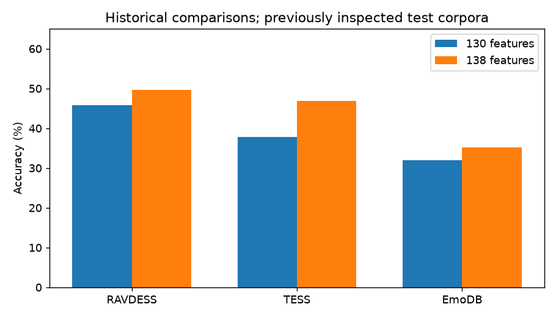
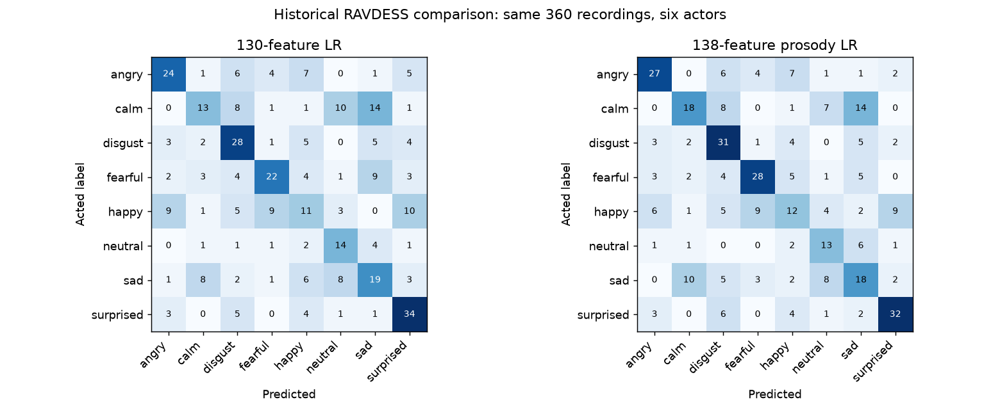

# VocalLens accuracy improvement — 23 November 2026

## Protocol and evidence

The pre-experiment [pipeline audit](ml_pipeline_audit.md) traces training, inference, split provenance and known leakage limitations. Existing reports/artifacts were preserved. New results are under `results/accuracy/`; they contain per-class precision/recall/F1, weighted F1, confusion matrices, parameters, actor splits and seeds. No accuracy target was assumed.

Historical RAVDESS/TESS/EmoDB tests and AV Actor 05 have already informed previous work. They are now historical development comparisons, **not newly untouched final tests**. Speech model selection uses the original 18 RAVDESS training actors with three-fold actor GroupKFold, plus TESS OAF fit-only clips. Actor IDs never cross fit/validation boundaries. Scaling, PCA and SelectKBest are inside fold pipelines. Each full fit uses 1,079 RAVDESS + 490 TESS samples. Validation contains about 360 RAVDESS clips per fold; exact counts and speaker IDs are in `search.json`. Pooled out-of-fold macro F1 is the new selection metric; it differs from averaging three fold F1 values.

## Voice comparisons

All first-stage candidates use the same 130 features and actor folds. Seed 42; LR is class-balanced, max_iter 2500; SVM uses RBF; detailed estimator parameters are saved.

| Candidate | Pooled training-actor CV macro F1 |
|---|---:|
| Current LR C=1 | 0.4201 |
| LR C=0.1 | 0.4099 |
| LR C=10 | 0.4159 |
| SVM C=1 / 10 / 30 | 0.3843 / 0.4116 / 0.4128 |
| ANOVA SelectKBest 80 + LR | 0.3873 |
| PCA 95% variance + SVM | 0.3972 |
| Extra Trees, 250 trees | 0.3676 |
| HistGradientBoosting, 100 iterations / 15 leaves | 0.4172 |

Trees, PCA and feature filtering did not beat the current LR. Additional XGBoost/LightGBM dependencies were not justified by these results. The search winner exactly reproduced the saved v2 historical RAVDESS result, confirming artifact/report agreement.

The next ablation added eight deterministic features: energy-gated YIN F0 median/std/90–10 percentile range, processed duration, RMS median/range/delta std and active-frame fraction. These are pitch estimates, not a validated voicing detector. The 65–500 Hz estimator can be unreliable on noise, unusual voices and non-speech. The original 130 features are unchanged. The shared `src/prosody.py` extractor is used by saved-model inference and evaluation.

| Ablation | Pooled CV macro F1 | Fold macro F1 values |
|---|---:|---|
| Original 130-feature LR | 0.4201 | 0.4442 / 0.3619 / 0.4218 |
| 138-feature prosody LR | **0.4511** | **0.4795 / 0.3835 / 0.4686** |
| 138-feature prosody SVM | 0.4296 | 0.4174 / 0.4047 / 0.4363 |
| 130-feature LR + mild noise | 0.4103 | 0.4198 / 0.3677 / 0.4172 |

Noise was 25 dB Gaussian noise on 270 seed-selected original training clips. Copies enter only their source actor's fit folds, never validation/test. Noisy features were not used in deployment. Volume-only augmentation is largely canceled by existing peak normalization; pitch shifts risk altering emotion cues and were not used. The initial experimental YIN/RMS hop mismatch failed explicitly and was corrected to a shared 512-sample hop before results were produced.

The prosody LR improved all three folds. Three folds are too few to claim statistical significance; there is no independent new natural-speech corpus. Historical transfer checks also improved, using the original corpus-specific supported labels for macro F1:

| Historical comparison | Samples | Old accuracy / macro F1 | Prosody accuracy / macro F1 |
|---|---:|---:|---:|
| RAVDESS six actors | 360 | 45.83% / 0.4512 | **49.72% / 0.4912** |
| TESS YAF | 1,400 | 37.79% / 0.3337 | **46.86% / 0.4063** |
| EmoDB | 454 | 31.94% / 0.3004 | **35.24% / 0.3383** |

The original search report uses all eight labels for its macro averages, including unsupported corpus classes; `prosody_historical.json` explicitly stores corpus source labels and is the correct table source above. These differing macro conventions must not be interchanged. Confusion matrices retain all eight prediction labels so wrong Calm predictions remain visible. Weighted F1 and per-emotion metrics are in that JSON.

The gain is not uniform: historical RAVDESS Sad recall changes 0.396→0.375, Neutral 0.583→0.542, Surprise 0.708→0.667. Fearful improves 0.458→0.583, Disgust 0.583→0.646, Angry 0.500→0.562, Calm 0.271→0.375, Happy 0.229→0.250. In particular, this speech upgrade does not solve subtle Sad recognition. These tradeoffs remain visible in the full report.





## Face and fusion protocol

The audited face pipeline has the correct seven-class order, 112×112 RGB alignment, [-1,1] scaling and softmax. No evidence supports changing labels or suppressing Neutral. The already available FER+ alternative is compared directly against the current OpenCV Zoo model on additional actors. No new face training or arbitrary rejection thresholds were introduced.

The [official OpenCV Zoo reference](https://github.com/opencv/opencv_zoo/tree/main/models/facial_expression_recognition) confirms MobileFaceNet, seven classes and RAF-DB evaluation; its [reference preprocessing](https://github.com/opencv/opencv_zoo/blob/main/models/facial_expression_recognition/facial_fer_model.py) supplies the normalization and landmark targets. VocalLens uses a robust partial-affine fit rather than that reference's least-squares implementation. This difference has not been isolated as an accuracy ablation. A complete pretrained face training-subject manifest was not available in this audit, so unseen identity relative to every pretraining source cannot be guaranteed.

Fusion development uses the previously inspected Actor 05 (52 shared-label clips; Calm excluded). The frozen grid compares voice weights 0.25/0.5/0.75 and temperature 1/2, plus an entropy-confidence rule. `fusion_frozen.json` was written before new actor results were opened. Actor 05 selected equal weighting with temperature 2: development accuracy 63.46%, macro F1 0.5969, compared with equal raw scores 61.54% / 0.575. This is only one additional correct clip and is not evidence of general improvement. Temperature is score softening, **not a claim of calibration**. NLL and ten-bin ECE are descriptive development measurements, not independently validated calibration. A high softmax score remains unreliable certainty.

New AV Actors 10 and 15 were reserved for a frozen check. Their speech-only recordings belong to the historical speech test, so the new AV check is independent of fusion/face tuning, but cannot be called a wholly new speech-corpus test. Each actor contributes 60 AV speech videos, of which 52 have the seven common labels. The evaluation retains voice, face, FER+, original equal fusion, the frozen temperature rule, and the prospectively specified prosody voice/fusion variants. No rule is tuned on these new outputs. Multiple actors remain essential: two additional actors still cannot establish broad generalization.

Before examining the final two-actor metrics, the deployment gate is: adopt the frozen softened rule only if it improves **both accuracy and macro F1 on each of Actors 10 and 15**, relative to equal averaging with the same new voice model. Otherwise retain equal averaging. The voice engine itself is selected from speech actor CV and historical transfer, rather than selecting it from these AV clips.

For a strictly same-input historical comparison, `actor05_prosody.json` reuses the original saved face scores and recomputes only the new voice scores from the same AV clips. Voice alone drops from 44.23% to **40.38%** on this actor; equal fusion rises 61.54%→**65.38%** (macro F1 0.575→**0.6208**). Softened fusion reaches 67.31% / 0.6540, but Actor 05 is development data and cannot justify deploying that rule by itself. This adverse voice-only example is not omitted.

## Resources, data and untested branches

The old speech artifact is 8,953 bytes; the prosody candidate is 9,401 bytes. On four local demo WAVs, v3 feature+inference took 0.082–0.105 seconds, while warm v2 samples took 0.033–0.069 seconds; first-use imports/feature initialization were several seconds. Measurements were sequential under concurrent work, not a controlled speed benchmark. Caching model artifacts by absolute path/mtime/size removes repeated deserialization and invalidates on replacement. No uploaded recording or prediction is cached. Face thread benchmarking found default ORT faster than a two-thread cap (about 1.01 vs 3.74 seconds for 12 repeated face frames), so the thread change was rejected. Exact observations are in runtime JSONs. Peak RAM/VRAM, CPU utilization and live hardware latency were not measured; GPU inference was not tested.

The [pretrained audio research](pretrained_audio_research.md) covers SUPERB wav2vec2, emotion2vec+ and audEERING, including primary model cards, label incompatibilities, licenses, sizes and training-overlap concerns. PyTorch/Transformers/FunASR are absent. Those models were not downloaded, run or fine-tuned; no transformer accuracy or latency is invented. An isolated optional four-class SUPERB evaluation remains future work. WavLM/HuBERT embeddings need a trained emotion head rather than a direct class mapping.

No new speech corpus was merged. RAVDESS is acted English; TESS has only two speakers; EmoDB is acted German. Exact duplicate filtering and actor provenance remain; a complete acoustic near-duplicate audit is still missing. CREMA-D access/licensing was reviewed; SAVEE and IEMOCAP require registration/agreement. FER2013/RAF-DB/AffectNet access limitations from the dataset guide still apply. Only two bounded optional AV ZIPs (~1.1 GB) were downloaded, checked against official MD5 and kept outside Git.

## Reproduction

```bat
.venv\Scripts\python.exe scripts\experiment_accuracy.py
.venv\Scripts\python.exe scripts\experiment_features.py
.venv\Scripts\python.exe scripts\evaluate_prosody.py
.venv\Scripts\python.exe scripts\experiment_fusion.py
.venv\Scripts\python.exe scripts\download_ravdess_av.py 10 15
.venv\Scripts\python.exe scripts\evaluate_new_av.py
```

The first three commands require the existing official speech datasets and validated v2 cache. Follow the previous dataset guide to regenerate that cache; do not replace historical result records during reproduction. Feature caches, raw archives and intermediate candidate artifacts remain ignored. Experiment outputs contain only small metrics and score records. Original baseline artifacts stay available for rollback.

## Frozen additional-actor results and deployment decision

Both actors had all 52 common-label clips available for every modality; no missing-face cases were dropped from these comparisons. Each face result averages up to 12 actual sampled frames. All figures below are from the **same 104 AV clips**, separate from the historical Actor 05 table:

| Method | Accuracy | Macro F1 |
|---|---:|---:|
| Original v2 speech | 48.08% | 0.4554 |
| Prosody v3 speech | **50.00%** | **0.4797** |
| FER+ face baseline | 23.08% | 0.1630 |
| Current OpenCV Zoo face | **49.04%** | **0.4126** |
| Original v2 speech + equal fusion | 58.65% | 0.5602 |
| v2 speech + frozen softened fusion | 56.73% | 0.5405 |
| Prosody v3 speech + equal fusion | **57.69%** | **0.5700** |
| Prosody v3 speech + frozen softened fusion | 56.73% | 0.5530 |

The softened rule failed its predeclared gate: on Actor 10, v3 equal accuracy/F1 are 61.54%/0.5240 versus softened 57.69%/0.4781; on Actor 15, equal is 53.85%/0.5235 versus softened 55.77%/0.5361. It helps one actor but harms the other and is **not deployed**. Per-actor, weighted F1, confusion matrices, exact scores, coverage and intended labels are saved in `new_av.json`.

The current face model is retained. Its new Sad recall is 13/16 (81.25%) versus FER+ 0/16; Neutral recall is 8/8 for both. This differs substantially from Actor 05, showing subject variation rather than a universal fix. No new face weights were trained or selected from these test actors.

The selected voice engine is **balanced Logistic Regression C=1, 138 features**, saved as `models/logistic_prosody_v3.joblib`. Its deployment gate verifies three-fold improvements, historical transfer gains, feature dimensions, C and raw-sample parity against the recorded feature cache. All older model files remain. `models/selected.json` records the artifact SHA-256 and fallback path. `src/predict.py` and the developer trace use the same v3 extractor.

**Deployed fusion remains equal averaging over shared classes.** The upgraded voice improves per-actor fusion macro F1 slightly on both new actors, but pooled fusion accuracy drops by one clip (61 correct → 60 correct). There is no claim of a convincing multimodal accuracy gain. Voice selection is supported by training CV and three historical corpus improvements; it still needs a new independent corpus, more speakers, and uncertainty intervals. A four-class pretrained trial and a larger out-of-fold AV development set are the next useful experiments.

Comparable historical before/after summary:

| Component | Previous | Deployed update | Interpretation |
|---|---:|---:|---|
| Voice, 360 historical RAVDESS clips | 45.83% | 49.72% | Same clips, +3.89 percentage points |
| Face, historical Actor 05 | 51.92% | 51.92% | Same retained face engine |
| Equal fusion, historical Actor 05 | 61.54% | 65.38% | Same 52 clips/face scores; development result |

The separate new-actor fusion result above is more cautious evidence and must accompany this historical table.

## Final verification and use

The final regression suite reports **34 passed, 3 warnings in 25.03s**, exit code 0. Syntax compilation and dependency checks passed. The updated Streamlit server started on localhost port 8503 and its health endpoint returned `ok`. The browser was not used for new upload QA in this ML pass; earlier UI tests and screenshots remain historical. Physical microphone/camera, CUDA, a fresh environment installation and peak-memory checks remain unverified.

Run `.venv\Scripts\python.exe -m streamlit run app.py` from the project directory. No speech dataset download is needed for inference; the selected 9.4 KB artifact is included. Face weights still use `scripts/download_face_model.py`. To select the retained 130-feature voice fallback, run `scripts/deploy_prosody.py --rollback-v2` with the same interpreter and restart the app. Re-deploying v3 through that training deployment script requires its local candidate/cache; ordinary inference uses the included v3 artifact directly.

The new model was trained on RAVDESS and TESS, whose noncommercial dataset terms remain applicable; this university demonstration does not grant commercial rights. Attribution and access details are retained in `data/EXPANDED_DATASETS.md`. No dataset media, ZIP, feature cache, optional transformer weights, secrets or unrelated TeX files are included in the change.
