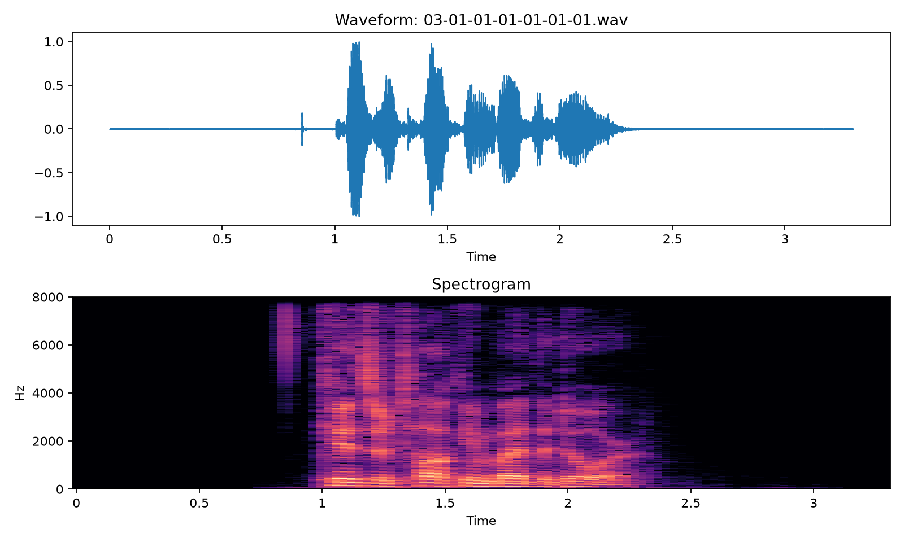
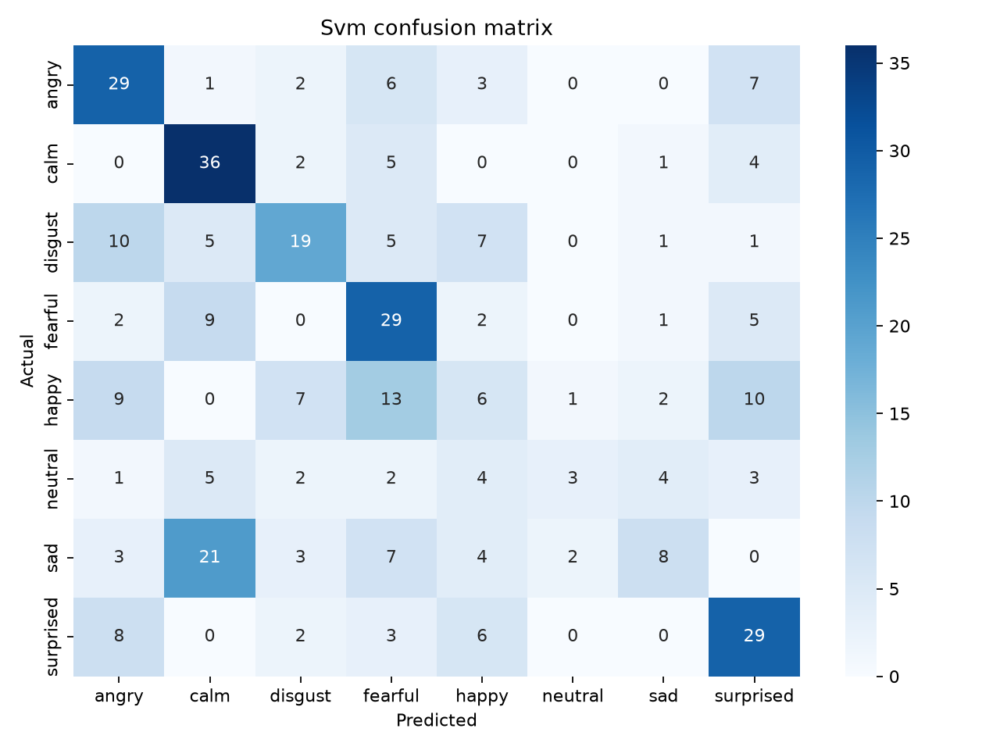

# VocalLens: Multimodal Emotion Recognition Through Speech and Facial Expressions

> **November 2026 expansion:** The following sections document the original RAVDESS-only 46-feature baseline and its historical selection. The currently deployed model is a 130-feature logistic regression trained on RAVDESS plus a TESS subset, chosen by training-only actor cross-validation. On the untouched six-actor RAVDESS test it scored **45.83% accuracy / 45.12% macro F1**, versus the saved SVM's **44.17% / 39.75%**. TESS's held-out speaker scored **37.79% / 33.37%** and unseen EmoDB **31.94% / 30.04%**. See the [expanded protocol, all metrics and limitations](expanded_model.md), [corpus licenses](../data/EXPANDED_DATASETS.md) and [current README](../README.md). Acted-corpus gains do not establish real-world accuracy. The project has no independent labeled face or multimodal accuracy result.

**Hear the voice. See the emotion.**

**Team:** Ahmad Ali Shah, Saboor Khan, Sardar Bilal  
**Status:** Audio evaluation, sample face inference, and local video upload analysis verified. Microphone and physical webcam capture remain unverified.

## Abstract and problem statement

This project classifies *acted vocal expression* in a short speech recording and estimates visible facial-expression categories in a photo or sampled video frames. It compares three CPU-friendly speech models using a speaker-independent test set and uses a separate pretrained FER+ facial model. A local Streamlit app shows the cues separately and offers an explicitly experimental combined score when both are present. It cannot determine a person's genuine feelings from voice or face.

## Objectives and dataset

The objectives are reproducible dataset checks, audio feature extraction, fair model comparison, and a working upload/record/predict interface. The input is audio-only speech from [RAVDESS](https://zenodo.org/records/1188976), published by Livingstone and Russo (2018). The downloaded official ZIP passed its published MD5 checksum and contained **1,440 WAV files from 24 actors**. One same-actor, same-label repetition is byte-identical to another and was excluded, leaving **1,439 usable recordings**. The target labels are neutral, calm, happy, sad, angry, fearful, disgust and surprised. All 1,440 WAV files have 48 kHz, 16-bit audio; 1,435 are mono and five stereo. Durations range from 2.936 to 5.272 seconds (mean 3.701 seconds). The dataset uses CC BY-NC-SA 4.0; the audio stays outside Git.

## Preprocessing and input features

`src.dataset_loader` checks filename fields and WAV integrity and removes byte-identical duplicates. Missing files are flagged through the observed count; unreadable or empty files are reported and excluded. There are no tabular null values to impute. Target names are used as categorical classes; scikit-learn encodes them internally. `src.feature_extraction` converts audio to mono 16 kHz, rejects short or silent audio, limits processing to 12 seconds, normalizes amplitude and extracts 46 summary features: 20 MFCC means, 20 MFCC standard deviations, and mean/standard deviation of RMS, zero-crossing rate and spectral centroid. Scaling is contained within the SVM and logistic regression pipelines, fitted only on training data. The random forest does not need scaling.

## EDA

`notebooks/exploratory_analysis.ipynb` and `python -m src.eda` count classes and actors and generate waveform and spectrogram plots from actual WAV files. The EDA run generated `results/figures/emotion_distribution.png`, `actor_distribution.png` and `sample_audio.png`; the class and sample-audio plots were visually checked. Neutral has 96 usable recordings, happy 191, and each of the other six classes 192. The neutral class is half the size of most others, supporting the use of macro F1. The sample waveform shows leading and trailing silence with speech concentrated near the middle; its spectrogram shows speech energy concentrated in changing bands below 8 kHz. These observations are descriptive, not evidence of classification performance.

## Methodology

Actors 05, 10, 15, 20, 23 and 24 form the held-out test group; the other 18 form training. This gives 1,079 training clips and 360 test clips, with no actor shared between groups. The fixed actor split reduces speaker leakage and is shared by all models. SVM with an RBF kernel and sigmoid probability calibration, random forest (200 trees), and class-weighted logistic regression are trained on the same 46 features. Calibration uses three folds within the training group only. The fixed seed is 42. Training outputs model files, a data audit, class reports, confusion matrices and a comparison chart. Accuracy, macro precision, macro recall and macro F1 are computed. Macro F1 is the main selection metric because it treats each emotion equally; accuracy can mask weak minority-class performance.

The original SVM calibration folds are ordinary folds within the 18 training actors and may contain clips from the same actor on both sides of an internal fold. The final six-actor test set is still wholly excluded from fitting and calibration. This limits how confidently calibration transfers to new speakers; it does not leak the held-out test actors into training. The tuning experiment below uses actor-disjoint outer validation folds.

## Results and selected model

The three models were trained and evaluated on the same 360 recordings from six held-out actors. The following are measured results from `results/model_comparison/comparison.csv`:

| Model | Accuracy | Macro precision | Macro recall | Macro F1 |
|---|---:|---:|---:|---:|
| Calibrated SVM | 0.4417 | 0.4391 | 0.4219 | **0.3975** |
| Logistic regression | 0.4000 | 0.4020 | 0.3932 | 0.3927 |
| Random forest | 0.3917 | 0.3740 | 0.3854 | 0.3738 |

The **calibrated SVM** was selected by the stated macro F1 rule and saved in `models/selected.json`; the app loads `models/svm.joblib`. It also has the highest accuracy and macro precision, though its macro F1 lead over logistic regression is only about 0.0048. This is a narrow difference on one fixed split, so it is not strong evidence of broad superiority. Its nonlinear boundary may capture feature relationships that the linear baseline misses; the forest's behavior may reflect sensitivity to this small feature dataset. These explanations are plausible interpretations, not proven causes.

The calibrated SVM confusion matrix shows 36/48 calm, 29/48 angry, 29/48 fearful, and 29/48 surprised clips correctly classified. Its weak classes include neutral (3/24), happy (6/48), and sad (8/48). Twenty-one sad clips were labeled calm, and thirteen happy clips were labeled fearful. The forest reached only 7/48 happy recall. These class errors explain why headline accuracy alone would be misleading. Full per-class classification reports and matrices are in `results/metrics/` and `results/figures/`.

## Application and demonstration

`app.py` accepts a WAV/MP3/FLAC/OGG upload or a browser microphone recording through Streamlit's `st.audio_input`. The user explicitly selects one input source, and the app displays the selected filename. It plays the input, extracts the same features, loads the saved selected model and displays the predicted expression and model score distribution. The Streamlit server returned HTTP 200. Browser uploads of an Actor_05 angry WAV and an Actor_10 happy WAV displayed **Angry** and **Happy**, respectively, with the selected filename changing each time. The result card, audio player and score chart rendered, and the displayed label matched the highest score. The microphone control rendered, but this browser session did not confirm a captured microphone sample. Missing model and bad audio produce actionable errors. Demo: show dataset validation, EDA figures, the comparison CSV, then analyze two real speech clips in the app.

## Repeated-prediction investigation

The original app showed both upload and microphone widgets and always chose a microphone recording when one existed, even after the user selected another file on the Upload tab. This could make apparently different uploads reuse one recorded clip. The app now renders only the chosen source, so a hidden recording cannot override an upload. The old simultaneous-input state was identified in code but could not be reproduced with a live microphone sample in the test browser.

An independent diagnostic used 24 real WAVs: eight emotions each from Actors 01, 05 and 10. The 46-feature vectors were finite, differed across all tested recordings, and matched between the training file-path and app bytes paths. The saved SVM predicted all eight classes across those 24 clips. Its 360-clip held-out confusion matrix also contains predictions in all eight classes, although neutral and sad are predicted infrequently. The model is therefore not globally stuck on one label; its low macro F1 and weak classes still limit generalization to ordinary microphone speech. The diagnostic input statistics, full score vectors and predictions are recorded in `results/metrics/prediction_diagnostics.json`. No model retraining was required for this app-input fix, so the measured comparison table above is unchanged.

## Facial expression pipeline and source

The face module uses OpenCV's pretrained frontal-face Haar cascade to find face regions. It selects the largest detected face in each frame, converts that crop to grayscale, resizes it to 64×64 pixels, and passes it to the [ONNX Model Zoo Emotion FER+ model](https://github.com/onnx/models/blob/main/validated/vision/body_analysis/emotion_ferplus/README.md). The model's eight outputs are neutral, happiness, surprise, sadness, anger, disgust, fear and contempt; the app displays grammatical variants happy, surprised, sad, angry and fearful. Softmax converts raw model scores to a distribution. The model is distributed under MIT terms and runs with ONNX Runtime on CPU. **Our group did not train this facial model or measure its classification accuracy.**

Camera input captures one browser still image. Uploaded videos are capped at 50 MB and two minutes. At most 12 frames are sampled evenly over the clip, and valid per-frame score vectors are averaged to create one face result. Frames without detected faces are skipped and counted. If no sampled frame contains a face, the app shows no facial result. If several faces appear, the largest detection in each frame is used with a visible warning; this may switch subjects across frames. No facial identity information is extracted or stored.

## Video audio and experimental fusion

`imageio-ffmpeg` extracts a mono 16 kHz WAV track from a video. The existing speech feature and saved-model pipeline processes that track. A video with no decodable audio can still produce a face result. A no-face video can still produce a voice result. The two single-cue predictions and charts remain visible.

The taxonomies share seven reasonably aligned expression names: neutral, happy, sad, angry, fearful, disgust and surprised. Audio **calm** and face **contempt** are omitted because there is no direct counterpart. Each distribution is renormalized over the seven shared classes, and corresponding scores are averaged with equal weights. This symmetric late-fusion display is an **experimental baseline**, not a calibrated joint probability model. Separate model scores need not be equally calibrated; no labeled multimodal test set was used, so **combined accuracy and F1 are unknown**. The app explicitly labels the combined output unvalidated.

## Exact repeated-prediction diagnosis and new tests

Three unrelated MP3s on the laptop had distinct SHA-256 hashes, decoded durations and 46-feature vectors. The crying file `universfield-female-crying-291098.mp3` yielded Fearful 0.407635; an angry stock MP3 yielded Fearful 0.444648; a child-laughter MP3 yielded Fearful 0.441609. Thus the top label repeated, but the score vectors were **not identical**. The crying and angry files were also uploaded through the real Streamlit browser interface and displayed distinct Fearful bars (0.408 versus 0.445). This ruled out a stale upload, stale chart and identical feature extraction in those tested flows. `scripts/diagnose_uploads.py` reproduces the byte, signal, feature and score inspection.

## Deep audio diagnosis and measured tuning experiment

The later investigation probed the actual calibrated SVM decision boundary. Two generated one-second tones had different SHA-256 hashes and 46-feature vectors, yet both returned the **identical eight-class probability vector**, topped by Fearful **0.444324897**. Their largest RBF similarity to any support vector in each calibrated estimator was only about 10⁻²⁰ to 10⁻²¹. For such distant inputs, the RBF kernel contributions become negligible; the SVM decision scores approach an almost fixed value, which its saved calibration maps to almost fixed probabilities. The stock angry MP3 had similarly weak maximum kernel similarity (about 0.006), yielding Fearful **0.444647515**. That raw value is **44.4648%**, displayed as **44.5%** by one-decimal rounding. The number is a genuine saved-model probability estimate, not a hardcoded default or trustworthy certainty. The crying MP3 was less extreme (maximum similarity about 0.23) and displayed **40.8%**. This explains both exact saturation on distant synthetic inputs and near-repetition on stock audio.

The new diagnostic passed the same 24 known-label RAVDESS clips through all three saved models, with all classes and three actors represented, and recomputed all models' predictions on the 360 held-out clips. Class ordering, highest-score labels, repeatability, and saved-model feature dimensions matched. All three measured metrics matched the original table above exactly. The original actor split remains disjoint, one duplicate was excluded, and preprocessing and scaling are shared by the app and evaluation. Detailed JSON, CSV, confusion matrices and prediction-distribution figure are in `results/diagnostics/`.

Five SVM C/gamma settings were compared using three actor-disjoint GroupKFold validation folds on the 18 training actors. A candidate selected by validation yielded **0.4472 accuracy / 0.4086 macro F1** on the untouched test actors, compared with the saved model's **0.4417 / 0.3975**. The difference is small, and a paired actor-bootstrap interval for macro-F1 improvement spans **-0.0146 to +0.0373**. The validation gap between this candidate and the current C=10 setting was about **0.00056**. We therefore **did not replace the saved model**: this single-split gain does not establish a dependable improvement. No trained artifacts or original evaluation metrics were overwritten.

As a descriptive distribution check, the median nearest-training-clip distance for held-out RAVDESS speech was **4.54** in training-scaled feature space, with maximum **8.26**. The crying, angry and laughter stock clips were **8.18**, **15.16** and **11.88**. This is not a validated out-of-distribution detector; it supports the interpretation that the stock clips are unlike acted RAVDESS speech. Their filenames do not provide a valid eight-class test set, so external-audio accuracy is unknown. The live browser analysis showed stock angry Fearful **44.5%**, crying Fearful **40.8%**, and held-out RAVDESS angry **38.7%**, with each chart matching its trace. The optional developer trace shows the active file, decoded signal, feature sample, model hash and full scores. The red Analyze button and result accent reuse the preexisting VocalLens red `#e46b72`; face and video processing were left intact.

The new implementation was tested with a sample face image, blank no-face image, a three-second local video made from repeated sample frames and a RAVDESS audio clip, and the same video without audio. The video produced 12 sampled face frames, a separate speech result, and an experimental combined result; the silent video produced no audio track. The Streamlit browser rendered the new branding, exact crying-file hash, voice chart, and all three video result cards. Physical webcam and microphone capture were not confirmed in this browser session. These are functional checks, **not facial or multimodal accuracy measurements**.

## Limitations and conclusion

RAVDESS uses acted North American English speech and a small number of speakers; real-world language, accents, noise, recording devices and spontaneous emotion may differ. SVM probability calibration aligns the label and score chart but does not make a score a reliable measure of someone's feelings. The fixed single split is reproducible but gives one estimate; a future extension could use group cross-validation. The measured macro F1 of 0.3975 shows substantial room for improvement, especially for neutral, happy and sad.

Frontal face detection may fail with profile views, occlusion or poor light. FER+ training conditions and our video inputs differ, and the model may be biased across populations; no independent face benchmark was conducted. Sampled frames can miss short expressions. Equal-weight fusion is a demonstration of integrating two classifiers and should not be used for high-stakes decisions.

## References

- Livingstone, S. R., & Russo, F. A. (2018). *The Ryerson Audio-Visual Database of Emotional Speech and Song (RAVDESS).* PLoS ONE 13(5), e0196391. https://doi.org/10.1371/journal.pone.0196391
- RAVDESS archive and license: https://zenodo.org/records/1188976
- scikit-learn documentation: https://scikit-learn.org/stable/
- librosa documentation: https://librosa.org/doc/latest/
- Streamlit documentation: https://docs.streamlit.io/
- ONNX Model Zoo FER+ model and MIT license: https://github.com/onnx/models/blob/main/validated/vision/body_analysis/emotion_ferplus/README.md
- ONNX Runtime Python documentation: https://onnxruntime.ai/docs/get-started/with-python
- OpenCV documentation: https://docs.opencv.org/4.x/db/d28/tutorial_cascade_classifier.html
