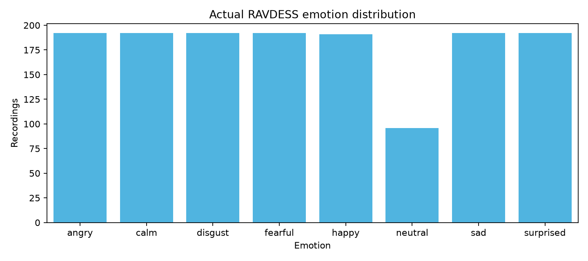
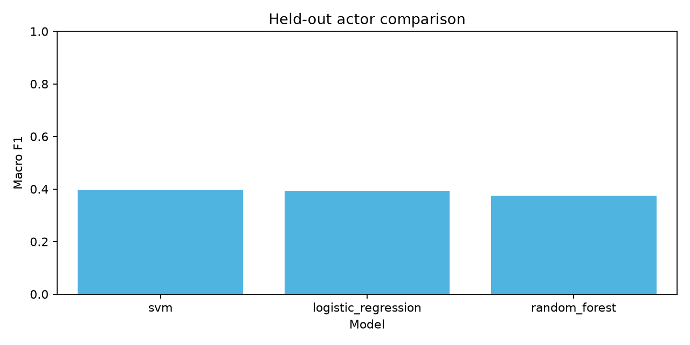

# Emotion Recognition Through Speech

**Team:** Ahmad Ali Shah, Saboor Khan, Sardar Bilal  
**Status:** Dataset, EDA, three-model training and browser upload prediction verified. Microphone capture remains unverified.

## Abstract and problem statement

This project classifies the *acted vocal expression* in a short speech recording into one of eight RAVDESS labels. It compares three CPU-friendly machine learning models using a speaker-independent test set and serves the selected saved model through a local Streamlit app. It cannot determine a person's genuine feelings from voice alone.

## Objectives and dataset

The objectives are reproducible dataset checks, audio feature extraction, fair model comparison, and a working upload/record/predict interface. The input is audio-only speech from [RAVDESS](https://zenodo.org/records/1188976), published by Livingstone and Russo (2018). The downloaded official ZIP passed its published MD5 checksum and contained **1,440 WAV files from 24 actors**. One same-actor, same-label repetition is byte-identical to another and was excluded, leaving **1,439 usable recordings**. The target labels are neutral, calm, happy, sad, angry, fearful, disgust and surprised. All 1,440 WAV files have 48 kHz, 16-bit audio; 1,435 are mono and five stereo. Durations range from 2.936 to 5.272 seconds (mean 3.701 seconds). The dataset uses CC BY-NC-SA 4.0; the audio stays outside Git.

## Preprocessing and input features

`src.dataset_loader` checks filename fields and WAV integrity and removes byte-identical duplicates. Missing files are flagged through the observed count; unreadable or empty files are reported and excluded. There are no tabular null values to impute. Target names are used as categorical classes; scikit-learn encodes them internally. `src.feature_extraction` converts audio to mono 16 kHz, rejects short or silent audio, limits processing to 12 seconds, normalizes amplitude and extracts 46 summary features: 20 MFCC means, 20 MFCC standard deviations, and mean/standard deviation of RMS, zero-crossing rate and spectral centroid. Scaling is contained within the SVM and logistic regression pipelines, fitted only on training data. The random forest does not need scaling.

## EDA

`notebooks/exploratory_analysis.ipynb` and `python -m src.eda` count classes and actors and generate waveform and spectrogram plots from actual WAV files. The EDA run generated `results/figures/emotion_distribution.png`, `actor_distribution.png` and `sample_audio.png`; the class and sample-audio plots were visually checked. Neutral has 96 usable recordings, happy 191, and each of the other six classes 192. The neutral class is half the size of most others, supporting the use of macro F1. The sample waveform shows leading and trailing silence with speech concentrated near the middle; its spectrogram shows speech energy concentrated in changing bands below 8 kHz. These observations are descriptive, not evidence of classification performance.

## Methodology

Actors 05, 10, 15, 20, 23 and 24 form the held-out test group; the other 18 form training. This gives 1,079 training clips and 360 test clips, with no actor shared between groups. The fixed actor split reduces speaker leakage and is shared by all models. SVM with an RBF kernel and sigmoid probability calibration, random forest (200 trees), and class-weighted logistic regression are trained on the same 46 features. Calibration uses three folds within the training group only. The fixed seed is 42. Training outputs model files, a data audit, class reports, confusion matrices and a comparison chart. Accuracy, macro precision, macro recall and macro F1 are computed. Macro F1 is the main selection metric because it treats each emotion equally; accuracy can mask weak minority-class performance.

## Results and selected model

The three models were trained and evaluated on the same 360 recordings from six held-out actors. The following are measured results from `results/model_comparison/comparison.csv`:

| Model | Accuracy | Macro precision | Macro recall | Macro F1 |
|---|---:|---:|---:|---:|
| Calibrated SVM | 0.4417 | 0.4391 | 0.4219 | **0.3975** |
| Logistic regression | 0.4000 | 0.4020 | 0.3932 | 0.3927 |
| Random forest | 0.3917 | 0.3740 | 0.3854 | 0.3738 |

The **calibrated SVM** was selected by the stated macro F1 rule and saved in `models/selected.json`; the app loads `models/svm.joblib`. It also has the highest accuracy and macro precision, though its macro F1 lead over logistic regression is only about 0.0048. This is a narrow difference on one fixed split, so it is not strong evidence of broad superiority. Its nonlinear boundary may capture feature relationships that the linear baseline misses; the forest's behavior may reflect sensitivity to this small feature dataset. These explanations are plausible interpretations, not proven causes.

The calibrated SVM confusion matrix shows 36/48 calm, 29/48 angry, 29/48 fearful, and 29/48 surprised clips correctly classified. Its weak classes include neutral (3/24), happy (6/48), and sad (8/48). Twenty-one sad clips were labeled calm, and thirteen happy clips were labeled fearful. The forest reached only 7/48 happy recall. These class errors explain why headline accuracy alone would be misleading. Full per-class classification reports and matrices are in `results/metrics/` and `results/figures/`.

## Application and demonstration

`app.py` accepts a WAV/MP3/FLAC/OGG upload or a browser microphone recording through Streamlit's `st.audio_input`. The user explicitly selects one input source, and the app displays the selected filename. It plays the input, extracts the same features, loads the saved selected model and displays the predicted expression and model score distribution. The Streamlit server returned HTTP 200. Browser uploads of an Actor_05 angry WAV and an Actor_10 happy WAV displayed **Angry** and **Happy**, respectively, with the selected filename changing each time. The result card, audio player and score chart rendered, and the displayed label matched the highest score. The microphone control rendered, but this browser session did not confirm a captured microphone sample. Missing model and bad audio produce actionable errors. Demo: show dataset validation, EDA figures, the comparison CSV, then analyze two real speech clips in the app.

## Repeated-prediction investigation

The original app showed both upload and microphone widgets and always chose a microphone recording when one existed, even after the user selected another file on the Upload tab. This could make apparently different uploads reuse one recorded clip. The app now renders only the chosen source, so a hidden recording cannot override an upload. The old simultaneous-input state was identified in code but could not be reproduced with a live microphone sample in the test browser.

An independent diagnostic used 24 real WAVs: eight emotions each from Actors 01, 05 and 10. The 46-feature vectors were finite, differed across all tested recordings, and matched between the training file-path and app bytes paths. The saved SVM predicted all eight classes across those 24 clips. Its 360-clip held-out confusion matrix also contains predictions in all eight classes, although neutral and sad are predicted infrequently. The model is therefore not globally stuck on one label; its low macro F1 and weak classes still limit generalization to ordinary microphone speech. The diagnostic input statistics, full score vectors and predictions are recorded in `results/metrics/prediction_diagnostics.json`. No model retraining was required for this app-input fix, so the measured comparison table above is unchanged.

## Limitations and conclusion

RAVDESS uses acted North American English speech and a small number of speakers; real-world language, accents, noise, recording devices and spontaneous emotion may differ. SVM probability calibration aligns the label and score chart but does not make a score a reliable measure of someone's feelings. The fixed single split is reproducible but gives one estimate; a future extension could use group cross-validation. The measured macro F1 of 0.3975 shows substantial room for improvement, especially for neutral, happy and sad.

## References

- Livingstone, S. R., & Russo, F. A. (2018). *The Ryerson Audio-Visual Database of Emotional Speech and Song (RAVDESS).* PLoS ONE 13(5), e0196391. https://doi.org/10.1371/journal.pone.0196391
- RAVDESS archive and license: https://zenodo.org/records/1188976
- scikit-learn documentation: https://scikit-learn.org/stable/
- librosa documentation: https://librosa.org/doc/latest/
- Streamlit documentation: https://docs.streamlit.io/
